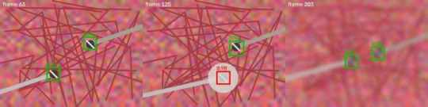

# Video Label Assist

I spent over two years at TikTok labelling and reviewing video by hand, and the thing I kept thinking was: most of these frames are easy. The hard part is knowing which ones aren't.

So I built a small workflow to test that idea. A person labels a few keyframes, a model fills in the frames in between, and anything the model isn't sure about goes back to a person. Then I measured whether it actually saves time without letting bad labels slip through.



*Green boxes are AI suggestions that were accepted. Red ones went to a person. In frame 125 the instrument is completely hidden by smoke, but the model still found a "best guess" with a score of 0.90. That's exactly the kind of mistake a human needs to catch.*

## A quick note on the video

The footage is synthetic. I generated it myself with OpenCV (`data/make_video.py`) so I'd know the correct answer for every single frame. It's a short surgical-style clip with two instruments moving through three phases, a stretch where smoke hides one instrument, and a stretch where the view goes blurry. No real patient footage is involved.

## How it works

A person labels every 10th frame. For the frames in between, OpenCV template matching looks for each instrument near where it was last seen and gives a confidence score for its guess.

If the score is below a threshold, the frame goes into a review queue for a person. I tuned that threshold on the first 180 frames only and then locked it, so the last 60 frames are a genuine test the method never saw.

I kept a few habits from audit and compliance work, because they matter when labels feed into anything regulated:

* AI suggestions and human-approved labels live in separate files, so you can always tell which is which.
* A manifest records the data fingerprints (hashes), the train and test split, the settings and the exact tool versions used.
* A second reviewer labels a blinded sample so I can check how much people agree with each other, not just with the model.

## What I found

On the 60 test frames, labelling took about **48% less time**, and every label was still correct. That figure assumes 6 seconds to draw a box and 1.5 seconds to check one, which are my estimates, not measurements. With real labellers I'd time both.

The interesting part was the failure case. With no human check at all, the model got **every smoke-hidden frame wrong**. The instrument wasn't visible, but template matching always returns its best guess, so it confidently drew a box on nothing. The review queue caught all 20 of those.

The threshold is also on the cautious side. Across the whole video it sent 47 perfectly clear frames to review as well. I could lower it to save more time, but I'd want more test data before trusting that.

Two reviewers agreed on boxes with a mean IoU of 0.76, and on procedure phases with a Cohen's kappa of 0.96. They only disagreed around the moments one phase turned into the next.

## What I'd take away

**Confident doesn't mean right.** A hidden instrument still scored 0.90. Hidden or partly hidden objects need their own check, not just a confidence score.

**Measure the people too.** My simulated reviewers agreed with each other less than the model agreed with the truth, which says more about how much hand wobble I simulated than about the model. On real footage, you'd measure both properly.

**Know what your data is missing.** Smoke and blur make up only about 5 to 6% of this clip. I wouldn't trust a model on those conditions until there was a lot more of them in the dataset.

## If I took this further with real footage

I'd plug it into a proper labelling tool like CVAT or Label Studio through their APIs, swap template matching for a real tracker or a segmentation model that can handle outlines, and send the frames the model is least sure about to clinicians first. And I'd time real labellers instead of estimating.

## Run it yourself

```
pip install -r requirements.txt
python data/make_video.py
python label_assist.py
```

Everything lands in `output/` (the report, manifest, review queue and preview image) and `labels/`. The labels and report come out identical every run. The video file itself is regenerated each time, so its hash can differ slightly between OpenCV versions.

Built with Python, OpenCV, NumPy and Pandas.
